# Lab 3 — Build a platform for shop

## Part 1 — Guardrails for the cluster

Выбрал Kyverno, потому что он используется у меня на работе. Он хоть и является менее зрелым продуктом, чем Gatekeeper, но активнее развивается. Kyverno проще, Kubernetes-native, и подходит для 99% ситуаций (если требуется специфическая логика, то тогда стоит перейти на Gatekeeper, т.к. там можно писать кастомные политики на языке rego).

Первоначально установим kyverno при помощи helm. 

Настроим `values`: kyverno имеет 4 контроллера:
- Admission controller: обязательный компонент. k8s API server перед выполнением запроса на изменение ресурса (`kubectl apply`) передаёт объект в webhook Kyverno, он попадает в этот контроллер, который, руководствуясь заданными политиками, запрещает создание ресурса / разрешает / изменяет ресурс (например, добавляет недостающие limits).
- Background Controller: выполняет асинхронные действия при изменении/создании объектов. Например, может создать/изменить какой-то k8s ресурс в ответ на появление/изменение на другого.
- Reports Controller: отвечает за отчеты, которые позволяют понять, какие ресурсы соответствуют / не соотвествуют политикам; статус применения политик и проверок.
- Cleanup Controller: удаляет k8s-ресурсы, согласно политикам. Например, можно настроить удаление завершенных Job старше какого-то времени раз в час.

Пока оставим все контроллеры, но заскейлим в 1 реплику для оптимизации потребления ресов.

Успешно задеплоились.

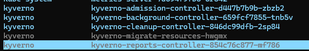

Напишем 5 политик:
- Автоматическое задание стандартных лимитов и реквестов, если не заданы
- Запрет на удаление лимитов, реквестов. И ограничение больших лимитов, реквестов.
- Разрешение образов только из доверенных регистри
- Запрет privileged-контейнеров
- Запрет на рут контейнеры

### Политика 1, 2: лимиты и реквесты

Используем [MutatingPolicy для стандартных requests и limits](./policies/mutate-default-limits-requests.yaml), чтобы задавать дефолтные ресурсы для подов, если они не заданы пользователем.

Логика такая: при создании пода, проверяется наличие в нём заданных лимитов и реквестов. Если любого из этого нет - задаётся дефолтное значение. При этом при помощи конструкции 

```yaml
autogen:
    podControllers:
        controllers:
        - deployments
        - statefulsets
        - daemonsets
        - jobs
        - cronjobs
```

ресурсы будут прокидываться не только в сам под, но и в абстракцию, которая им управляет (перечислены выше). Таким образом, вайбкодерам труднее будет захватить наш кластер приложениями с неописанными ресурсными требованиями.

В пару к этой политике добавим [ValidatingPolicy для проверки requests и limits](./policies/validate-limits-requests.yaml), которая при изменении пода будет проверять наличие реквестов и лимитов, и отклонять изменение, если их нет. Также будем отклонять лимиты или реквесты, которые будут больше заданного потолка. Если вайбкодер обошел первую политику, и задал memory limit: 999Gi, то тут мы его схватим за хвост.

### Политика 3: non-root

[Политикой обязательного запуска не от root](./policies/validate-run-as-non-root.yaml) проверим, что для пода или для всех контейнеров пода задано `securityContext.runAsNonRoot`, для того, чтобы предостеречься от получения злоумышленником рута на хосте из контейнера, при помощи какого-нибудь эксплойта.

### Политика 4: запрет привилегий

[Политика запрета privileged-контейнеров](./policies/validate-disallow-privileged.yaml) похожа на предыдущую. Здесь запретим запускать контейнеры в привилегированном режиме (в обход seccomp и прочих механизмов ограничений, с получением почти всех capabilities). Зачем это надо - понятно.

### Политика 5: проверка разрешенных регистри

[Политика разрешённых registry](./policies/validate-trusted-registries.yaml) позволяет использовать образы только из заданного списка registry, чтобы в кластер не попали скомпрометированные или небезопасные образы.

Разрешим список регистри:

```json
[
    "docker.io",
    "ghcr.io",
    "quay.io",
    "registry.k8s.io",
    "192.168.0.242:3000"
]
```

### Проверка

Проверим политики.

Применим манифест:

```yaml
apiVersion: v1
kind: Pod
metadata:
  name: trigger-limit-validation
  namespace: default
spec:
  securityContext:
    runAsNonRoot: true
  containers:
    - name: app
      image: alpine:3.19
      command: ["sh", "-c", "sleep 3600"]
      resources:
        requests:
          cpu: 50m
          memory: 64Mi
          ephemeral-storage: 16Mi
        limits:
          cpu: "3"
          memory: 128Mi
          ephemeral-storage: 64Mi
```

Здесь указан слишком высокий лимит cpu, а так же неподходящий регистри.

Получаем ошибку по двум политикам:

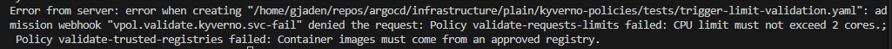

Проверим нонрут и запрет привилегий.

Манифест:

```yaml
apiVersion: v1
kind: Pod
metadata:
  name: trigger-privileged-validation
  namespace: default
spec:
  securityContext:
    runAsNonRoot: true
  containers:
    - name: app
      image: quay.io/test:3.19
      command: ["sh", "-c", "sleep 3600"]
      securityContext:
        privileged: true
      resources:
        requests:
          cpu: 50m
          memory: 64Mi
          ephemeral-storage: 16Mi
        limits:
          cpu: 100m
          memory: 128Mi
          ephemeral-storage: 64Mi
```

Ошибка:

```bash
Error from server: error when creating "/home/gjaden/repos/argocd/infrastructure/plain/kyverno-policies/tests/trigger-privileged-validation.yaml": admission webhook "vpol.validate.kyverno.svc-fail" denied the request: Policy validate-disallow-privileged failed: Privileged mode is forbidden. Every container must leave securityContext.privileged unset or set it to false.
```

Нонрут манифест:

```yaml
apiVersion: v1
kind: Pod
metadata:
  name: trigger-run-as-non-root-validation
  namespace: default
spec:
  containers:
    - name: app
      image: quay.io/alpine:3.19
      command: ["sh", "-c", "sleep 3600"]
      resources:
        requests:
          cpu: 50m
          memory: 64Mi
          ephemeral-storage: 16Mi
        limits:
          cpu: 100m
          memory: 128Mi
          ephemeral-storage: 64Mi
```

Ошибка:

```bash
Error from server: error when creating "/home/gjaden/repos/argocd/infrastructure/plain/kyverno-policies/tests/trigger-run-as-non-root-validation.yaml": admission webhook "vpol.validate.kyverno.svc-fail" denied the request: Policy validate-run-as-non-root failed: Every container must run as non-root. Set spec.securityContext.runAsNonRoot to true, or set securityContext.runAsNonRoot to true on every container.
```

И проверим мутацию, выставляющую дефолтные лимиты.

Манифест:

```yaml
apiVersion: v1
kind: Pod
metadata:
  name: trigger-mutate-default-resources
  namespace: default
spec:
  securityContext:
    runAsNonRoot: true
    runAsUser: 1000
  containers:
    - name: app
      image: quay.io/alpine:3.19
      command: ["sh", "-c", "sleep 3600"]
```

Видим дефолтные ресурсы из политики:

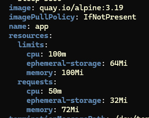

All good.

## Part 2 — Chart for api and worker | Part 3 — Postgres through an operator

Переделаем [чарт](./helm/lab3-app/) с предыдущей лабы, чтобы он включал в себя 2 компонента: [апи](./api/app.py) и [воркер](./worker/worker.py).

Для того, чтобы не прописывать несколько раз одни и те же шаблоны с разными именами, применим конструкцию [`range`](./helm/lab3-app/templates/deployment.yaml), которая позволит нам срендерить один и тот же шаблон несколько раз для списка переменных (в нашем случае - ["api", "worker"]).

Сбилдим образы апи и воркера, запушим в локальный регистри. Сбилдим чарт и запушим в тот же регистри.

Тут немножко заспидраним пункт 3 - задеплоим базу - и потом вернёмся к пункту 2, так как для успешного деплоя приложения ему нужно по-хорошему подключиться к базе и инциализировать её.

Установим cloudnative pg оператор чартом.

В чарт добавим [темплейт для создания кластера постгри](./helm/lab3-app/templates/database.yaml):

```yaml
{{- if .Values.database.enabled }}
apiVersion: postgresql.cnpg.io/v1
kind: Cluster
metadata:
  name: {{ .Values.database.clusterName }}
  labels:
    {{- include "lab3-app.labels" . | nindent 4 }}
    app.kubernetes.io/component: database
spec:
  imageName: {{ .Values.database.imageName }}
  instances: {{ .Values.database.instances }}
  bootstrap:
    initdb:
      database: {{ .Values.database.name }}
      owner: {{ .Values.database.owner }}
  storage:
    size: {{ .Values.database.storage.size }}
{{- end }}
```

URL базы для приложения будем доставать из секрета, создаваемого кластером, в [`values.yaml`](./helm/lab3-app/values.yaml).

```yaml
valueFrom:
    secretKeyRef:
        name: lab-db-app
        key: uri
```

Деплоим чарт. Видим, что кластер насоздавал всякого, значит оператор работает.

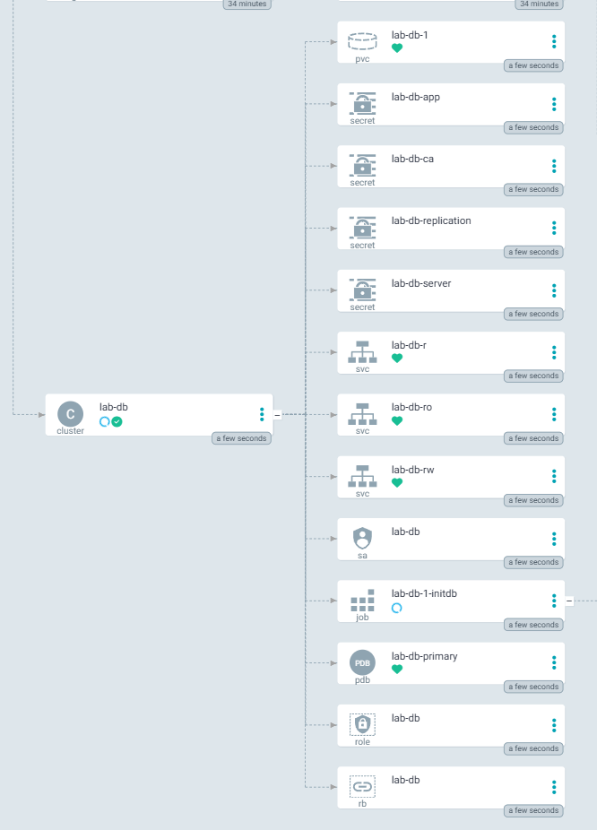

При этом приложение тоже успешно встало и инциализировало БД.

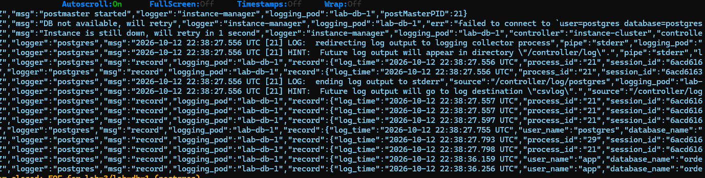

Посмотрим созданный ресурс

В спеке хранится желаемое состояние кластера, которое мы передали оператору. В нашем случае это один инстанс PostgreSQL 18, база `orders` с владельцем `app`, диск размером `2Gi` и включённый `PodMonitor`:

```yaml
spec:
  imageName: ghcr.io/cloudnative-pg/postgresql:18
  instances: 1
  bootstrap:
    initdb:
      database: orders
      owner: app
  monitoring:
    enablePodMonitor: true
  storage:
    size: 2Gi
```

Оператор дополнил спеку значениями по умолчанию, и в статус записал наблюдаемое фактическое состояние. На момент проверки кластер здоров и является primary:

```yaml
status:
  currentPrimary: lab-db-1
  instances: 1
  readyInstances: 1
  instancesStatus:
    healthy:
      - lab-db-1
  phase: Cluster in healthy state
  pvcCount: 1
  writeService: lab-db-rw
  readService: lab-db-r
  conditions:
    - type: Ready
      status: "True"
      reason: ClusterIsReady
```

В конфигурацию кластера добавим мониторинг с помощью

```yaml
monitoring:
    enablePodMonitor: {{ .Values.database.monitoring.enabled }}
```

С интернетов скачаем и импортируем готовый борд в графану.

На борде видим активный коннекшн

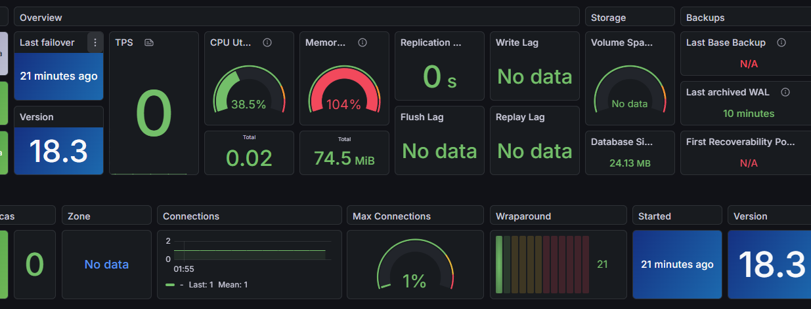

`kube-controller-manager` - компонент control plane Kubernetes. Он запускает стандартные контроллеры, которые управляют встроенными ресурсами и общим состоянием кластера. Например, Deployment, ReplicaSet, Job.

Оператор - кастомное приложение со своими CRD и контроллером. CloudNativePG наблюдает ресурс за своими ресурсами, например, `Cluster` и в зависимости от их состояния приводит кластер в нужное состояние: создаёт поды базы, PVC, секреты. Также оператор умеет правильно выполнять различные дейтсвия: обновление базы, переключение мастера и т.д.

То есть разделение такое: kube-controller-manager отвечает за реконсиляцию стандартных ресурсов и корректную работу кластера в целом, а оператор реализует кастомную логику и реконсилирует лишь свои CRD.

Доделаем второй пункт. Проверим реконсиляцию. Удалим под и он создастся заново:

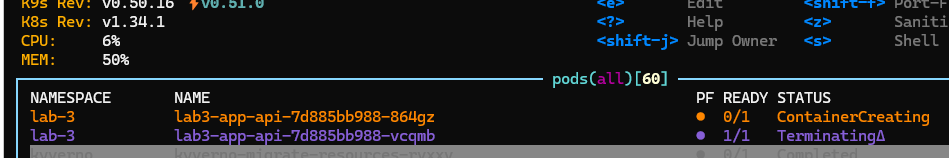

Изменим количество реплик и кол-во подов станет соответсвовать кол-ву реплик.

Проверим rolling update - метод обновления приложения, при котором сначала поднимается под новой версии, а потом убивается под старой версии, пока все поды не станут новой версии. Таким образом добивается нулевой даунтайм - в любой момент времени есть приложение, в которое можно достучаться через сервис. Для проверки заапдейтим версию образа и будем долбить ручку /health.

rolling update в работе:

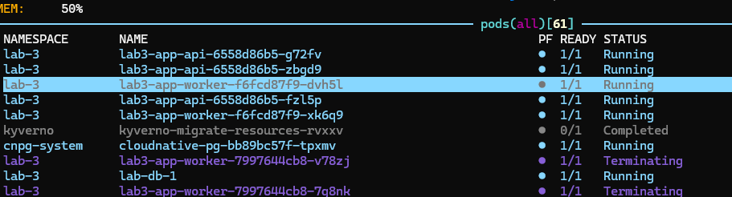

Все запросы прошли успешно

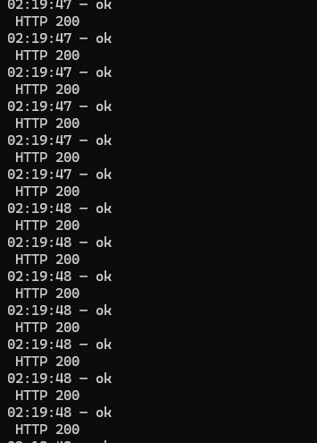

Проверим как поведет себя приложение при неуспешной раскатке. Врубим `HEALTH_FAIL=true`, чтобы приложение не встлао.

Видим картину: новый под висит в постоянной перезагрузке, не проходя рединесс пробу. При этом старые уходить не торопятся - потому что для того, чтобы контроллер начал удалять старые поды, в этой стратегии сначала должно появиться достаточное количество новых здоровых подов (количество можно регулировать в деплоймент параметрах `maxUnavailable` и `maxSurge`).

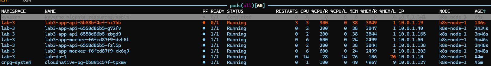

В арго прожмём роллбек и видим что приложение снова здравствует

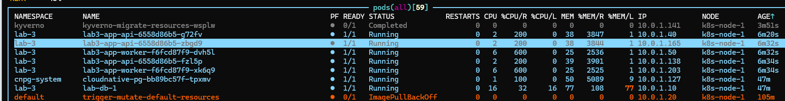

## Part 4 — Control plane failure

Сделаем DR-тест нашему великолепному кластеру. Для этого вырубим центральный управляющий компонент - аписервер. Без аписервера нельзя читать и изменять состояние кластера через Kubernetes API: не будут реконсилироваться контроллеры, и мы не сможем достучаться до кластера например через kubectl. 

Ломаем аписервер: `sudo mv /etc/kubernetes/manifests/kube-apiserver.yaml /tmp`

При попытке обращения к нему получаем ошибку

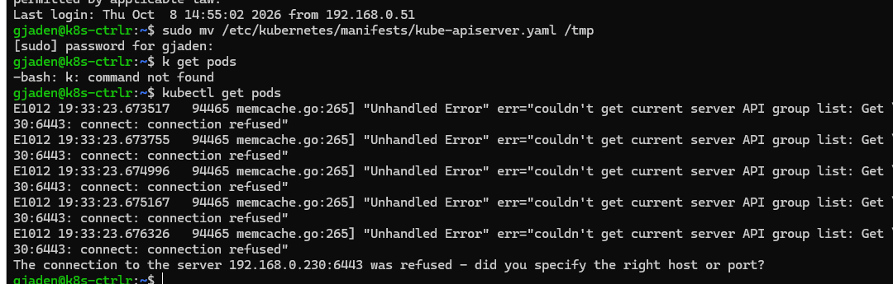

Проверим что приложение и БД работают не смотря на падение апишки:

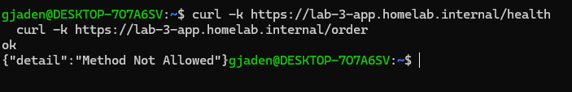

Возвращаем аписервер и апишка снова доступна по kubectl.

## Part 5 — Monitoring

Мониторинг и алертинг работают с предыдущей лабы.

Добавим 3 алерта в [PrometheusRule](./helm/lab3-app/templates/monitoring/prometheusrule.yaml), а метрики подключим через [ServiceMonitor](./helm/lab3-app/templates/monitoring/servicemonitor.yaml):

- `Lab3ContainerRestarting` срабатывает, если один из контейнеров приложения перезапускался за последние пять минут.
- `Lab3ApiMetricsTargetDown` срабатывает, если в пром перестали попадать метрики приложения. Это позволяет заметить падение пода, сервиса, сети.
- `Lab3DeploymentReplicasUnavailable` сравнивает желаемое и реально кол-во реплик. Он обнаруживает зависшее обновление или недостаточную доступность приложения.

Проверим первый алерт. Как раз контейнер сейчас рестартует из-за `HEALTH_FAIL`. Посмотрим в проме:

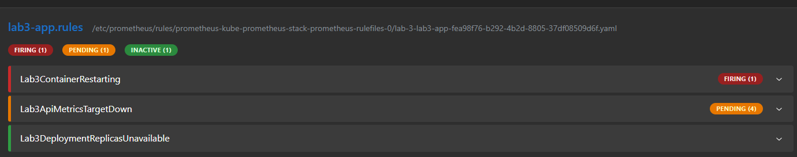

и в тг:

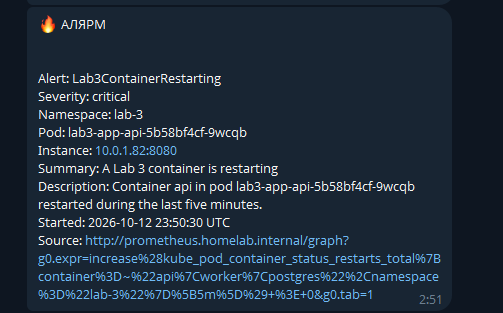
