# Lab 4 — SLA of the critical path under overload

## Part 0 — The batch service

чатжепети спасибо

Файлы: [`batch.py`](batch/batch.py), [`Dockerfile`](batch/Dockerfile),
[`api/app.py`](api/app.py), [`worker/worker.py`](worker/worker.py).

## Part 1 — Pick a spreading mechanism

Выберем механизм распределения подов при шедулинге: `podAntiAffinity` или `topologySpreadConstraints`.

`podAntiAffinnity` позволяет задавать правила типа "этот под не должен шедулиться на ноду, на которой есть поды подходящие под запрос (по лейблам)". Обычно это используют, чтобы запускать поды одной абстракции в нескольких репликах на разных нодах (не обязательно нодах, но и группах нод) для создания отказоустойчивости / геораспределенности.

Интересный момент из доки:

```
Inter-pod affinity and anti-affinity require substantial amounts of processing which can slow down scheduling in large clusters significantly. We do not recommend using them in clusters larger than several hundred nodes.
```

При этом необходимо задать `topologyKey`, указывающий на лейбл ноды, который определяет её принадлежность к группе. То есть можно сделать так: 4 ноды, у двух лейбл topology.kubernetes.io/region=Russia, у двух topology.kubernetes.io/region=America. Тогда с антиаффинити один под может быть размещён на любой ноге в регионе Russia, а второй - на любой Американской ноде.

`topologySpreadConstraints` отвечает за равномерное распределение подов по зонам (группам).

Я буду использовать `topologySpreadConstraints`, потому что он кажется более универсальным, и может частично заменять AntiAffinity во многих сценариях.

```yaml
topologySpreadConstraints:
  - maxSkew: 1
    topologyKey: topology.gjaden.dev/zone
    whenUnsatisfiable: ScheduleAnyway
```

`maxSkew` означает максимальное отклонение от "равновесия", т.е. дельта между зоной с самым большим количеством подом и самым маленьким.

Для логического распределения подов добавлю worker-нодам отдельные лейблы
`topology.gjaden.dev/zone=AZ-1` / `topology.gjaden.dev/zone=AZ-2`.
Стандартный `topology.kubernetes.io/zone=homelab` оставлю за Proxmox CSI:
для локального `local-lvm` он должен совпадать с именем физической Proxmox-ноды.

## Part 2 — A tight cluster

batch добавляем в шаблоны, чтобы у него тоже был свой деплоймент и деплоим наш чарт в кластер.

Шаблон: [`deployment.yaml`](helm/lab4-app/templates/deployment.yaml).
Скрипты сборки: [`build-push-images.sh`](build-push-images.sh),
[`build-push-chart.sh`](build-push-chart.sh).

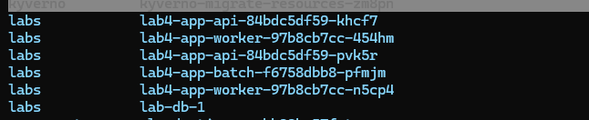

## Part 3 — Real numbers instead of guessing

Нагрузим приложеньку при помощи инструмента тестирования (в том числе и нагрузочного) Grafana k6.

Её можно установить в кластер в качестве оператора, но можно запускать и локально с cli, что я и сделаю.

Заставим выполнять команду для создания заказа:
```bash
curl -X POST 'https://lab-app.homelab.internal/order' \
    -H 'Content-Type: application/json' \
    -d '{"item":"coffee","quantity":1}'
```

Напишем наш тест на языке js

Файл теста: [`k6/test.js`](k6/test.js).

```js
import http from 'k6/http';
import { check } from 'k6';

export const options = {
iterations: 10,
insecureSkipTLSVerify: true,
};

export default function () {
const response = http.post(
    'https://lab-app.homelab.internal/order',
    JSON.stringify({
    item: 'coffee',
    quantity: 1,
    }),
    {
    headers: {
        'Content-Type': 'application/json',
    },
    },
);

check(response, {
    'order created': (response) => response.status === 201,
});
}
```

Вы спросите: "а в чем тут плюс k6? чем отличается от того что я просто запущу скрипт"

А я вам отвечу:

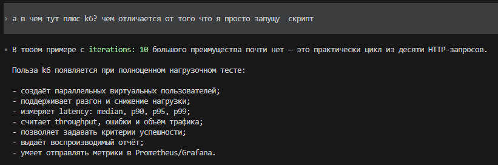

Вот посмотрите какой красивый отчет:

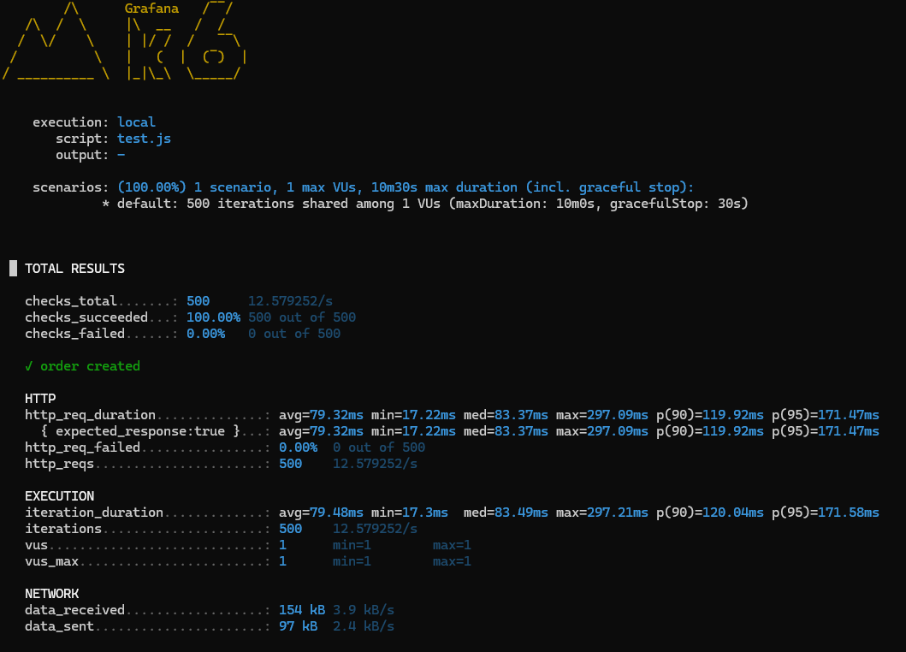

После того как создали нагрузку, используем тулу `krr` для определения оптимальных парметров ресурсов для приложения по метрикам реального потребления из прометеуса.

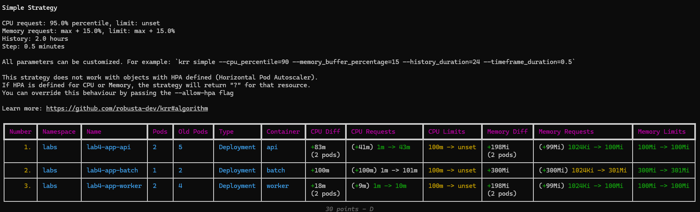

Видим, что реквесты нам рекомендуют поднять (для памяти делать этого я). А с лимитами по памяти я угадал. А вот лимиты по ЦПУ рекомендуют убирать в принципе, так как он приносит больше вреда, чем пользы. Установим ресурсы в соответствии с рекомендациями.

Тут я понял что убрать лимиты по цпу у нас не получится из-за политик куверно) Так что поправим политики чтобы не выставляли лимит по цпу и не валидировали ег

## Part 4 — Spread the critical service

В **Part 1** я уже объяснил преимущество использования этой функции (topologySpreadConstraints и антиаффинити).

Включим этот механизм для нашего приложения:

Файлы: [`values.yaml`](helm/lab4-app/values.yaml), [`deployment.yaml`](helm/lab4-app/templates/deployment.yaml).

```yaml
topologySpreadConstraints:
  - maxSkew: 1
    topologyKey: topology.gjaden.dev/zone
    whenUnsatisfiable: DoNotSchedule
    minDomains: 2
```

Поды действительно запустились на разных нодах

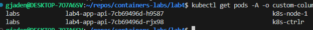

## Part 5 — Set priorities and guarantees

### PriorityClass

priorityClass - объект, обозначающий приоритет пода. Чем выше value класса, тем выше приоритет. При шедулинге, если под не может зашедулиться и на нодах есть поды с более низким приоритетом, выселив (evict), которые, под с более высоким приоритетом сможет зашедулиться, то они будут evicted.

Добавим шаблон priorityClass, создадим 2 класса: один с высоким приоритетом, один с низким. С высоким поставим для api, postgres, а с низким - для batch.

Шаблон: [`priorityClass.yaml`](helm/lab4-app/templates/priorityClass.yaml).

```yaml
priorityClasses:
  - name: high-priority
    value: 1000000
    description: High priority
  
  - name: low-priority
    value: 500000
    desription: Low priority
```

### PDB

PodDisruptionBudget - ресурс, позволяющий ограничить, сколько подов группы (по лейблу, обычно подов одного приложения) кубернетес может вывести из работы одновременно. Это полезно, когда мы хотим обеспечить высокую доступность приложения при работах: drain нод, обслуживание кластера.

Включим его для апи, указав, что максимум в любой момент времени в недоступном (не ready) состоянии может находиться лишь 1 под:

Шаблон: [`poddisruptionbudget.yaml`](helm/lab4-app/templates/poddisruptionbudget.yaml).

```yaml
podDisruptionBudget:
    enabled: true
    maxUnavailable: 1
    unhealthyPodEvictionPolicy: ""
    annotations: {}
    labels: {}
```


### QoS

Kubernetes назначает различный **Quality of Service (QoS)** класс в зависимости от соотношения 
**requests / limits** контейнеров в этом поде.

В случае, когда на ноде начинают заканчиваться ресурсы, Kubernetes будет **evict**'ить поды с QoS в таком порядке:
- **BestEffort
- **Burstable
- **Guaranteed

Для каждой группы сервисов также можно зарезирвировать ресурсы.
Например, есть 12 CPU на ноде, мы выделили 4 CPU в BestEffort. Если есть свободные незарезервированные ресурсы (8 CPU), то их может забрать под с QoS **Burstable**.

#### Guaranteed

**Guaranteed** - гарантия того, что поды не будут эвиктиться, если кроме них есть еще какие-либо поды с более низким QoS.
Условия получения:
Для каждого контейнера в поде необходимо выполнение условий:
- Memory limit is set && Memory request is set
- Memory limit == Memory request
- CPU limit is set && CPU request is set
- CPU limit == CPU request
т.е реквесты и лимиты должны существовать у всех контейнеров и везде реквесты должны равняться лимитам.

#### Burstable

 Условия:
 - У хотя бы одного из контейнеров указаны лимиты или реквесты.
 
  Limits не обязательны, дефолтяться в the capacity of the Node

#### BestEffort

Условие:
Все контейнеры не имеют лимитов и реквестов.

Чтобы у api, postgres был Guaranteed QoS, выставим им такие ресы:

```yaml
database:
  resources:
    requests:
      cpu: 100m
      memory: 100Mi
    limits:
      cpu: 100m
      memory: 100Mi
```

```yaml
api:
  resources:
    requests:
      cpu: 43m
      memory: 100Mi
    limits:
      cpu: 43m
      memory: 100Mi
```

А для batch выставим ресурсы под `BestEffort`:

```yaml
resources:
requests:
    cpu: 10m
    memory: 32Mi
limits:
    cpu: 20m
    memory: 64Mi
```

## Part 6 — Create scarcity, catch preemption

Доскейлили батч до заполнения кластера, не влезшие поды висят в пендинге. Смотрим причину пендинга:

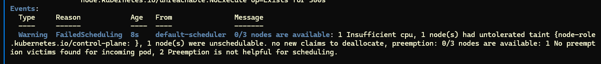

Недостаточно CPU и preemption не помогает - потому что поды батч имеют наименьший приоритет и никого вытеснить не могут.

Далее попробуем заскейлить новый под api

Состояние до:

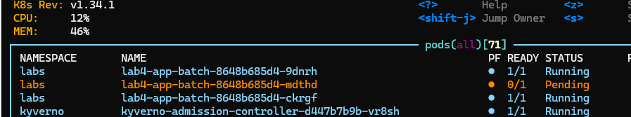

После:

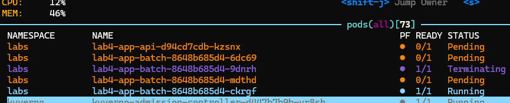

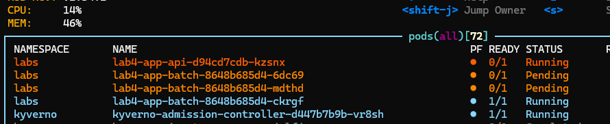

Как мы видим, куб удалил поды батча чтобы дать место апишке.

## Part 7 — Memory pressure, the eviction order

Проверим работу QoS при нехватке памяти на ноде.

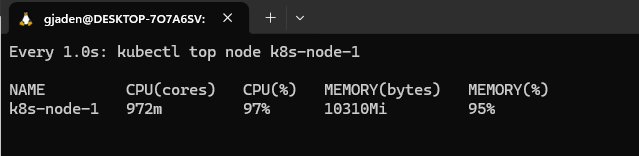

В течение часа пытался словить этот eviction. Не получилось, попросту разваливался кластер раньше. А всё потому, что для ноды стоял слишком маленький порог evictionHard.memory.available: 100Mi. Я поставлю 1Gi и попробую еще раз.

УРА ПОЛУЧИЛОСЬ - батч словил eviction

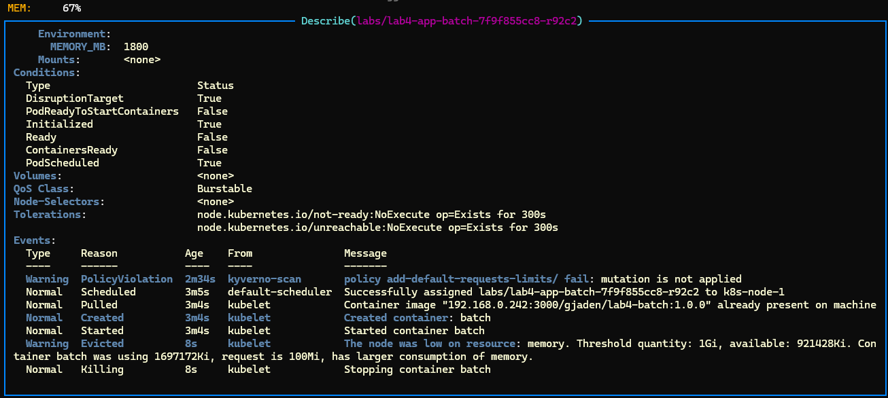

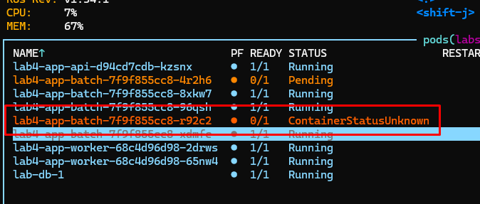

## Part 8 — Prove the SLA under load

Пусть SLA будет: 95% заказов выполняются не дольше 500 ms

Фигачим нагрузку 5 заказов в секунду с k6.

Сценарий и SLA thresholds: [`k6/test.js`](k6/test.js).

Кластер в нормальном состоянии:

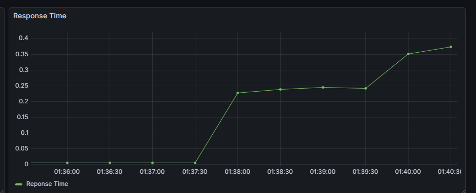

кончаются ресурсы при деплое - preemption (part 6)

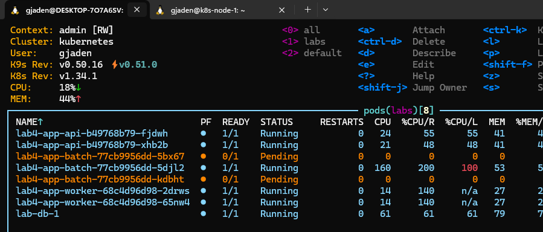

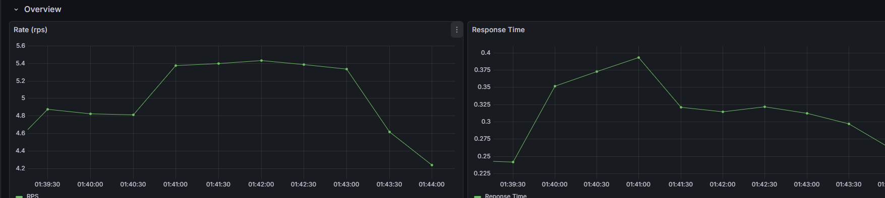

SLA соблюдался

eviction при недостатке памяти на ноде (part 7)


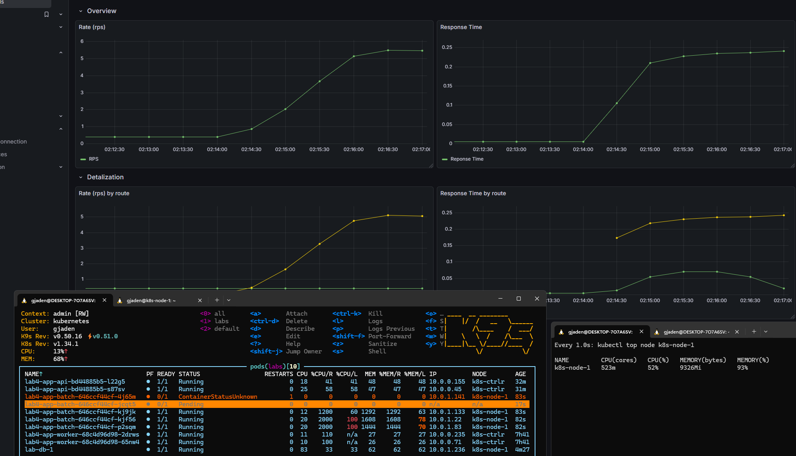

Видим eviction пода батч и остальные поды приложения не пострадали =). СЛА в порядке.


## Part 9 — Monitoring

Напишем алёрты.

Файлы: [`ServiceMonitor`](helm/lab4-app/templates/monitoring/servicemonitor.yaml),
[`PrometheusRule`](helm/lab4-app/templates/monitoring/prometheusrule.yaml),
[`values.yaml`](helm/lab4-app/values.yaml). Конфигурация Argo CD:
[`app.yaml`](argo/app.yaml), [`values.yaml`](argo/values.yaml).

### `Lab4ApiHighLatency`

Правило вычисляет p95 длительности критического запроса `POST /order` за пять
и сравнивает его с SLA 500 ms:

```promql
histogram_quantile(
  0.95,
  sum by (le) (
    rate(api_http_request_duration_seconds_bucket{
      namespace="labs", service="lab4-app-api",
      method="POST", route="/order"
    }[5m])
  )
) > 0.5
```

Это важный алерт, так как говорит о нарушении пользовательского контракта SLA

### `Lab4ApiHighErrorRate`

Вычисляет долю ответов `5xx` среди всех ответов `POST /order` за пять
минут.

```promql
sum(rate(api_http_requests_total{
  namespace="labs", service="lab4-app-api",
  method="POST", route="/order", status_code=~"5.."
}[5m]))
/
clamp_min(sum(rate(api_http_requests_total{
  namespace="labs", service="lab4-app-api",
  method="POST", route="/order"
}[5m])), 0.001) > 0.01
```

Это критический алерт, говорящий об ошибках на критической продуктовой функции приложения - создание заказов

### `Lab4CriticalPodUnschedulable`

```promql
kube_pod_status_unschedulable{namespace="labs"} == 1
and on (namespace, pod)
kube_pod_info{namespace="labs", priority_class="high-priority"}
```

Алерт говорит о том что поды с высоким priority_class (критические поды) не могут зашедулиться. Это может отразиться на работе приложения.

### Проверка срабатывания

Для проверки создадим временный Pod с `high-priority` и `nodeSelector`, которому не
соответствует ни одна нода. Pod останется `Pending`, но не будет потреблять ресурсы:

```bash
kubectl -n labs run lab4-alert-test \
  --image=192.168.0.242:3000/gjaden/lab4-api:1.0.1 \
  --restart=Never \
  --overrides='{"spec":{"priorityClassName":"high-priority","nodeSelector":{"alert-test":"unavailable"}}}'
```

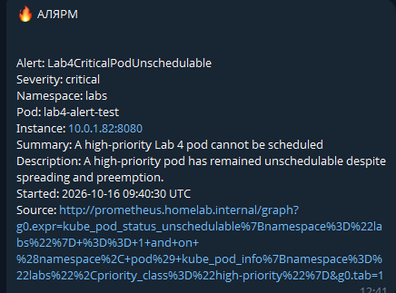
