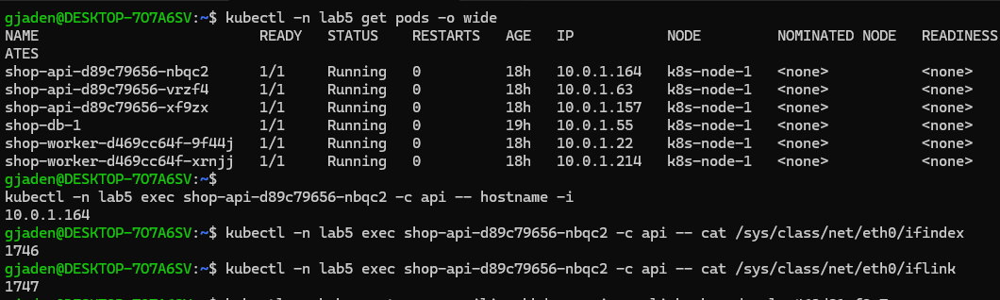
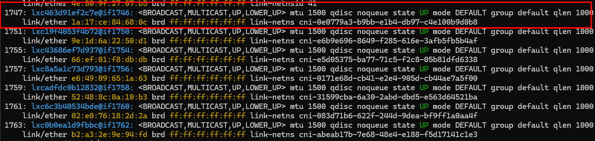
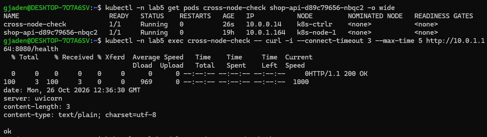
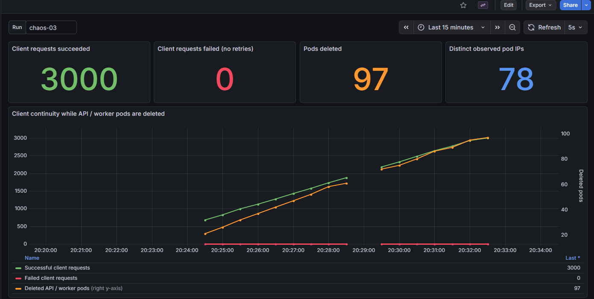
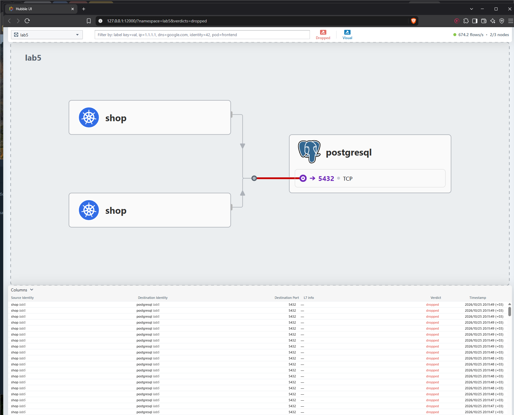
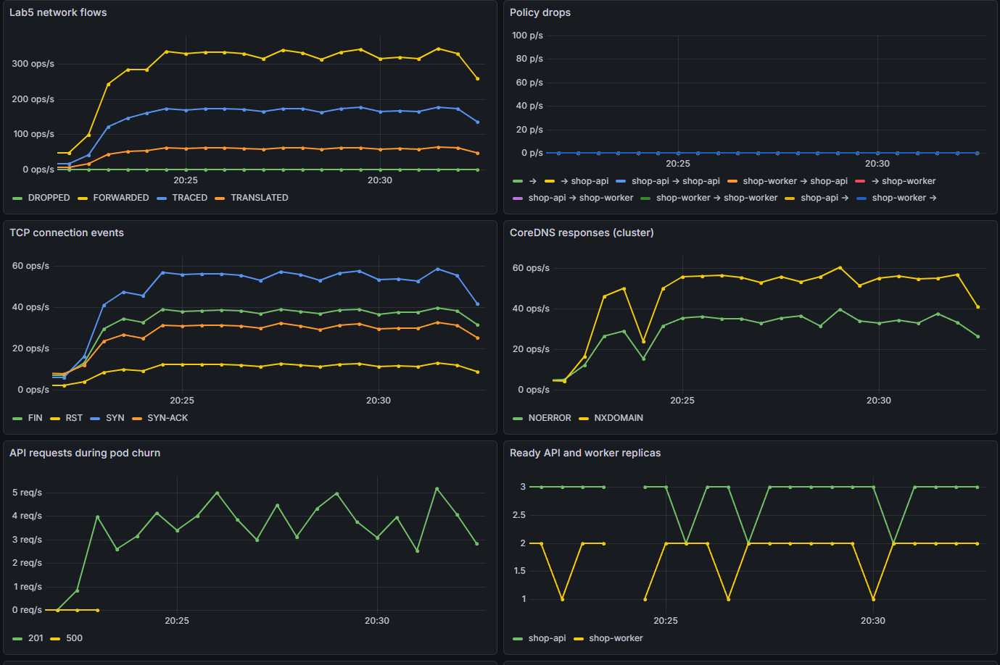

# Lab 5 - Zero-trust network with proof

## Part 0 - Pick a CNI

Выбрал Cillium, так как у нас он используется на работе, и кажется в принципе более распространен. И также интересно воспользоваться Hubble'ом для визуализации трафика.

## Part 1 - Deploy shop and explore pod networking

В кластере установил Cillium в режиме замены kubeproxy. Задеплоил чарт.

Посмотрим IP подов и сетевые интерфейсы внутри них.



У пода на скриншоте адрес `10.0.1.164`, он находится на ноде `k8s-node-1`. У пода есть интерфейс eth0 с ID 1746, который подключен к интерфейсу с ID 1747. Посмотрим интерфейсы на ноде node-1 (`ip link`). Видим среди кучи интерфейсов наш.



Проверим доступность подов с разных нод по IP. Создадим дебаг под и с него сделаем curl нашего апи.



Получили ответ от приложения. Сетевая связность между нодами работает.


## Part 2 - Prove continuity through pod chaos

Для апи настроим сервис типа NodePort как самый простой вариант принятия трафика в кубернетес.

Разница между типами сервисов:

- **NodePort** открывает порт на всех нодах кластера.
- **LoadBalancer** получает айпи адрес от внешнего балансировщика. Обычно этот тип вешают на ингресс-контроллеры (или что там в новых версиях куба..). В нашем кластере такие адреса выдаёт MetalLB.
- **Headless** сервис не получает внутрикластерного айпи, но позволяет через DNS получать адреса лежащих под ним подов. Выбор конкретного адреса тогда ложится на клиента.

Запустим скрипт, который раз в пять секунд удаляет случайный под апи или воркера. Параллельно будем создавать 5 заказов в секунду в течение 10 минут. В это время будем долбиться в апи по имени сервиса `shop-api.lab5.svc.cluster.local`.

Скрипты: [`chaos_metrics.py`](scripts/chaos_metrics.py), [`load_client.py`](scripts/load_client.py).

Для получения красивой статы эту штуку гпт предложил запустить прям в кубе, собрать с неё метрики и отобразить в графане:



Как мы видим абсолютно все запросы были успешно обработаны.

Почему это работает:

- Сервис имеет стабильный айпи адрес, в который резолвится наш DNS.
- Сервис по лейблам определяет, на какие поды отправлять запросы.
- EndpointSlice хранит актуальные адреса подов и их готовность.
- Cilium обновляет eBPF-map'ы и направляет запросы на доступные поды.

Так же помогают наличие нескольких реплик подов, и настроенные readiness пробы.

Обычно трафик сервисов обрабатывает kube-proxy. У него есть режимы iptables и IPVS:

- **iptables** создаёт правила перенаправления с адреса сервиса на поды. Чем больше сервисов и подов, тем больше правил и затрат на их обработку и обновление.
- **IPVS** использует балансировщик в ядре Linux с хеш-таблицами и разными алгоритмами выбора пода, например round-robin и least connections. Лучше масштабируется при большом числе сервисов, но требует модулей ядра и всё равно использует iptables для части сетевых правил.

В нашем кластере kube-proxy полностью заменён Cilium. Выбор пода и перенаправление трафика сервисов выполняются через eBPF.

## Part 3 - Design the target access matrix


| Источник | Назначение | Порт | Ожидание |
|---|---|---|---|
| Диагностический клиент | API | TCP 8080 | Разрешено |
| Внешний клиент из локальной сети | API через NodePort | TCP 30085 → 8080 | Разрешено |
| API | PostgreSQL | TCP 5432 | Разрешено |
| Worker | PostgreSQL | TCP 5432 | Разрешено |
| API, worker, PostgreSQL, клиент | CoreDNS | UDP/TCP 53 | Разрешено |
| Prometheus | API /metrics | TCP 8080 | Разрешено |
| Prometheus | PostgreSQL /metrics | TCP 9187 | Разрешено |
| CNPG operator | PostgreSQL management | TCP 8000 | Разрешено |
| PostgreSQL | Kubernetes API | TCP 6443 | Разрешено |
| PostgreSQL | Pod того же кластера БД | TCP 5432, 8000 | Разрешено для масштабирования БД |
| Посторонний Pod | API, worker, PostgreSQL, DNS | Соответствующие порты | Запрещено |
| API / worker | Другие Pod и внешняя сеть | Любые | Запрещено |

## Part 4 - Turn on zero trust

Добавим политики в [чарт](helm/shop/templates/networkpolicy.yaml).

Сначала запретим весь входящий и исходящий трафик в неймспейсе - default-deny. Потом разрешим трафик в соответствии с таблицей.

## Part 5 - Prove the matrix in practice

Проверим правила на практике. До включения политик посторонний под мог подключиться к апи и базе. Проверим что происходит теперь для основных случаев.

**Внешний клиент -> апи через NodePort: разрешено**

Команда

```bash
curl -s -o /dev/null -w 'HTTP %{http_code}\n' http://192.168.0.231:30085/health
```

Вывод

```text
HTTP 200
```

**Клиент -> апи: разрешено**

Команда

```bash
kubectl -n lab5 exec lab5-client -c nettools -- \
  sh -c 'nc -vz -w 3 10.0.1.163 8080 2>&1; echo exit=$?'
```

Вывод

```text
Connection to 10.0.1.163 8080 port [tcp/http-alt] succeeded!
exit=0
```

**Апи и воркер -> PostgreSQL: разрешено**

Команды

```bash
kubectl -n lab5 exec shop-api-d89c79656-fdw4b -c nettools -- \
  sh -c 'nc -vz -w 3 shop-db-rw.lab5.svc.cluster.local 5432 2>&1; echo exit=$?'

kubectl -n lab5 exec shop-worker-d469cc64f-k5vbp -c nettools -- \
  sh -c 'nc -vz -w 3 shop-db-rw.lab5.svc.cluster.local 5432 2>&1; echo exit=$?'
```

Вывод в обоих случаях

```text
Connection to shop-db-rw.lab5.svc.cluster.local 5432 port [tcp/postgresql] succeeded!
exit=0
```

Заодно проверили доступ по DNS-имени сервиса базы.

**Посторонний под -> PostgreSQL: запрещено**

Команда

```bash
kubectl -n lab5 exec lab5-stray -c nettools -- \
  sh -c 'nc -vz -w 3 10.0.1.55 5432 2>&1; echo exit=$?'
```

Вывод

```text
nc: connect to 10.0.1.55 port 5432 (tcp) timed out: Operation in progress
exit=1
```

**Посторонний под -> апи и воркер: запрещено**

Команда

```bash
kubectl -n lab5 exec lab5-stray -c nettools -- sh -c \
  'nc -vz -w 3 10.0.1.163 8080 2>&1; echo api_exit=$?;
   nc -vz -w 3 10.0.1.81 8081 2>&1; echo worker_exit=$?'
```

Вывод

```text
nc: connect to 10.0.1.163 port 8080 (tcp) timed out: Operation in progress
api_exit=1
nc: connect to 10.0.1.81 port 8081 (tcp) timed out: Operation in progress
worker_exit=1
```

У запрещённых подключений Hubble показал `POLICY_DENIED`. Значит, соединение блокируется политикой.

**Доступ к DNS: разрешено**

Проверим DNS по UDP и TCP. Здесь exit=0 означает, что получили ответ с IP сервиса.

Команда

```bash
kubectl -n lab5 exec lab5-client -c nettools -- sh -c \
  'dig +time=2 +tries=1 @10.96.0.10 shop-api.lab5.svc.cluster.local A +short | grep -Eq "^[0-9]+\\.[0-9]+\\.[0-9]+\\.[0-9]+$"; echo udp_exit=$?;
   dig +tcp +time=2 +tries=1 @10.96.0.10 shop-api.lab5.svc.cluster.local A +short | grep -Eq "^[0-9]+\\.[0-9]+\\.[0-9]+\\.[0-9]+$"; echo tcp_exit=$?'
```

Вывод

```text
udp_exit=0
tcp_exit=0
```

**CNPG operator -> БД и PostgreSQL -> Kubernetes API: разрешено**

Проверим подключения из дебаг-контейнеров оператора и БД.

Команды

```bash
kubectl -n cnpg-system exec deploy/cloudnative-pg -c nettools -- \
  sh -c 'nc -z -w 3 10.0.1.55 8000; echo operator_db_exit=$?'

kubectl -n lab5 exec shop-db-1 -c nettools -- \
  sh -c 'nc -z -w 3 192.168.0.230 6443; echo db_kubeapi_exit=$?'
```

Вывод

```text
operator_db_exit=0
db_kubeapi_exit=0
```

БД подключается к API на `6443`, оператор - к management-порту БД `8000`.

**Мониторинг: работает**

Проверим, что Prometheus может подключиться к портам метрик апи и БД, а SQL-порт базы и воркер для него закрыты.

Команда

```bash
kubectl -n monitoring exec prometheus-kube-prometheus-stack-prometheus-0 -c nettools -- sh -c \
  'nc -z -w 3 10.0.1.163 8080; echo api_metrics_exit=$?;
   nc -z -w 3 10.0.1.55 9187; echo db_metrics_exit=$?;
   nc -z -w 3 10.0.1.55 5432; echo db_sql_exit=$?;
   nc -z -w 3 10.0.1.81 8081; echo worker_exit=$?'
```

Вывод

```text
api_metrics_exit=0
db_metrics_exit=0
db_sql_exit=1
worker_exit=1
```

## Part 6 - Find the hidden connectivity break

Подготовим четыре варианта поломки: неправильный лейбл в политике, неправильный порт, отсутствие DNS у апи или доступа воркера к базе. [Скрипт](scripts/fault.py) выбирает один случайно.

Заказы перестали создаваться. Откроем Хаббл, посмотрим только DROPPED.



Видим красное соединение к PostgreSQL на порту **5432**. В деталях - запросы от апи и воркера, причина `POLICY_DENIED`, направление **EGRESS**. Значит, блокируется выход к базе.

Лезем в политику. Лейблы базы правильные, а порт разрешён **5433** вместо **5432**. Поэтому подключение и блокируется.

Вернём порт `5432` и повторим проверки. Матрица снова зелёная, заказ создаётся с HTTP `201`.

## Part 7 - Monitoring

Включаем метрики Hubble.

В [чарт](helm/shop/templates/monitoring) добавим ServiceMonitor, PrometheusRule и ConfigMap с дашбордом.



На дашборде видны запросы клиента, удаления подов, новые IP, сетевой трафик, дропы и ответы DNS.

### Lab5PolicyDrops

```promql
sum(rate(hubble_drop_total{
  reason="POLICY_DENIED", source_namespace="lab5"
}[1m])) > 0
```

Срабатывает, когда политики постоянно блокируют трафик. Поможет заметить ошибку в правилах или постороннего клиента. Уровень warning, потому что приложение при этом может продолжать работать.

### Lab5DNSFailures

```promql
sum(rate(coredns_dns_responses_total{rcode="SERVFAIL"}[2m])) > 0
```

DNS возвращает серверные ошибки, из-за которых приложение может перестать находить сервисы по именам.

### Lab5NetworkMetricsUnavailable

```promql
absent(up{job="hubble-metrics"}) or min(up{job="hubble-metrics"}) == 0
```

Пропали метрики Hubble. Без них можно не заметить сетевую проблему и принять пустой график за отсутствие ошибок.
