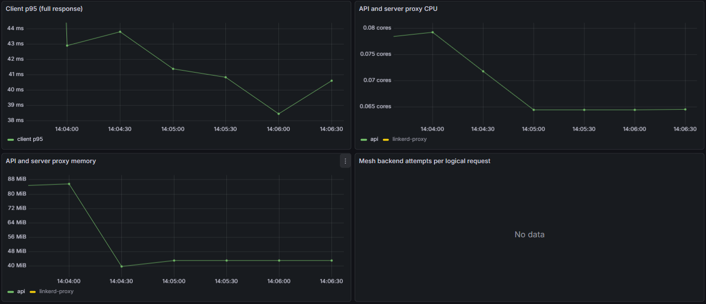
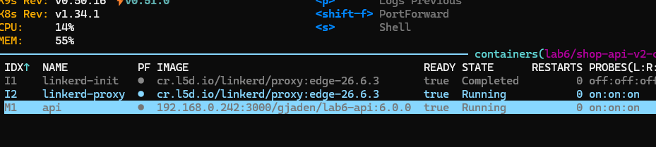
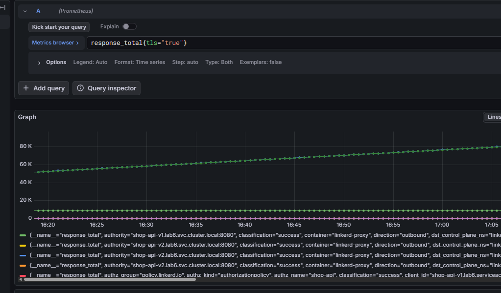
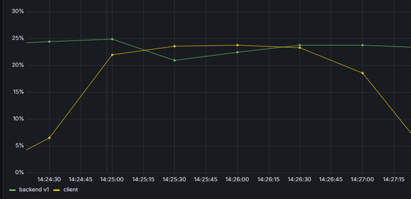
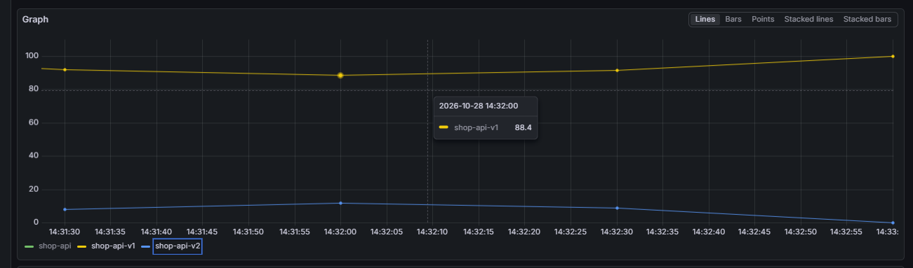
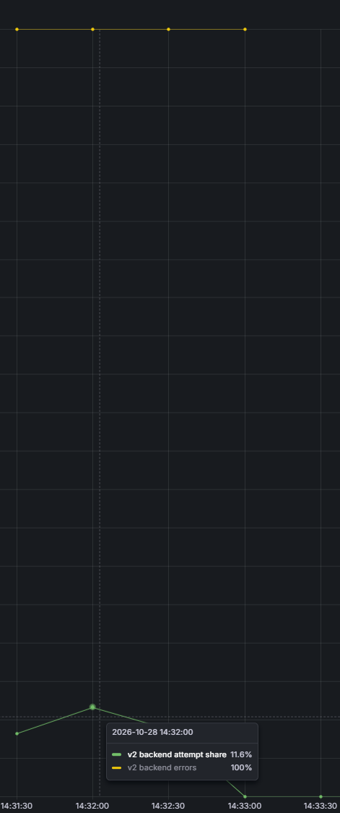
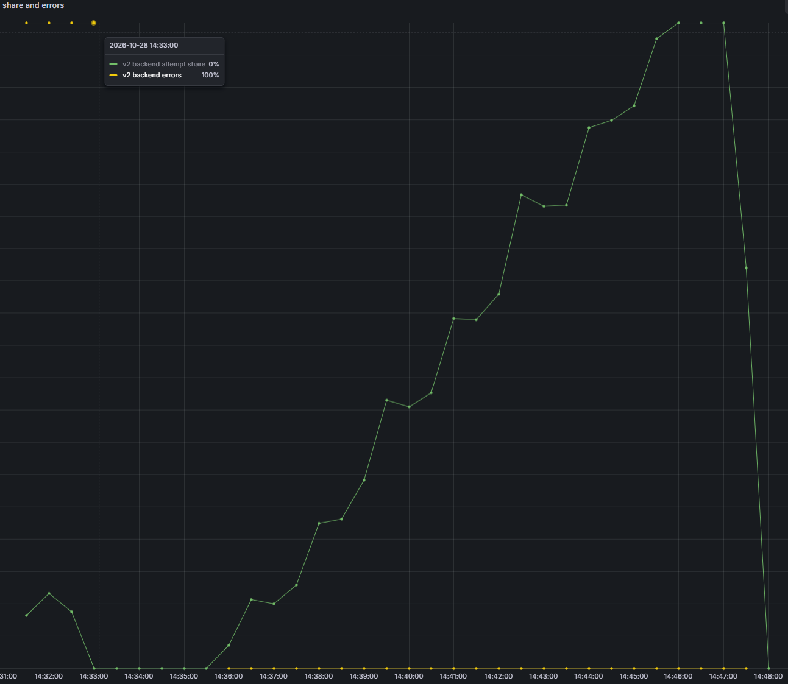
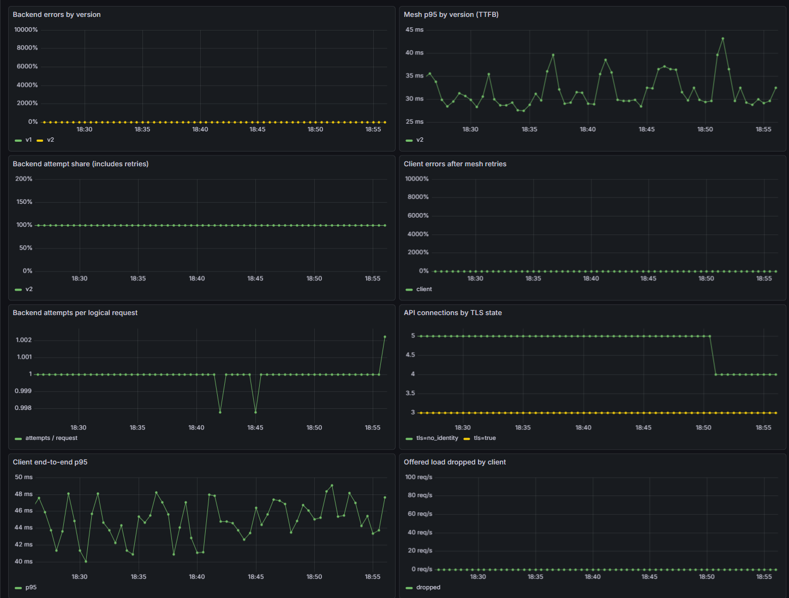

# Lab 6 - Autopilot release

## Part 0 - The services

Навайбкодили сервис и гейт.

## Part 1 - Pick a mesh

Выбрал Linkerd для лабы, потому что он проще и потому что с ним еще не работал.

## Part 2 - Measure the baseline

Деплоим первую версию апи и грузим запросами при помощи скрипта.

Собираем p95, CPU и RAM апи.

## Part 3 - Enable mesh and mTLS

Включим linkerd прокси, который добавляется в качестве сайдкара к подам. Он обрабатывает сетевой трафик: шифрует соединения и применяет заданные правила.

Добавим наши поды в меш при помощи аннотации `linkerd.io/inject: enabled`.

Появились контейнеры linkerd.

У каждой версии апи используется свой ServiceAccount, который выступает в качестве identity сервиса в mTLS.

Запросы проходят, приложение работает. Соберём метрики с linkerd proxy и на ней также видно что запросы проходят с шифрованием tls.

## Part 4 - Reliability for free

Включим режим flaky для v1. Сначала проверим без ретраев, потом с ними.

В [HTTPRoute](helm/shop/templates/route.yaml) настроил три ретрая при ответах 5xx. В итоге получится до четырёх попыток на один запрос.

Посмотрим на график:

До включения ретраев (до 14:26:50) количество ошибок на сервисе и у клиента было одинаковое. После включения - количество ошибок пользователю упало до меньше 1%.

| Режим | Ошибки backend | Ошибки клиента | Попыток на запрос |
|---|---:|---:|---:|
| Без retry | 23,62% | 23,43% | 1,000 |
| С retry | 23,30% | 0,19% | 1,304 |

Апи продолжает возвращать ошибки, но клиент почти их не видит, значит механизм ретраев отрабатывает корректно.

## Part 5 - Deploy v1/v2 and split traffic

Развернём обе версии апи. В HTTPRoute зададим веса: 90% на v1 и 10% на v2.

Нагрузим приложение и посмотрим реальное распределение запросов по метрикам.

Из 1000 запросов получили 907 ответов v1 и 93 ответа v2, то есть 90,7% и 9,3%.

## Part 6 - Build the autopilot

[Гейт](gate/gate.py) раз в 15 секунд получает из Prometheus ошибки и p95 создания заказа на api v2 и меняет веса HTTPRoute через kubectl.

Правила:

- После запуска и каждого изменения веса ждёт 75 секунд, чтобы накопились метрики.
- Для решения нужно хотя бы 30 попыток на v2 за минуту.
- Если ошибок 5% и больше или p95 достиг 500 мс - откатывает весь трафик на v1.
- После двух успешных проверок увеличивает долю v2 на 15 процентов.
- На 100% ещё раз проверяет здоровье версии и завершает работу.
- Если метрик нет или их недостаточно, оставляет текущие веса.

## Part 7 - Test both scenarios

**Плохой релиз**

У v2 включён `FAIL=true`. Ожидаем, что после накопления метрик гейт увидит ошибки и изменит веса с 90/10 на 100/0.

На первой проверке через 75 секунд гейт увидел 100% ошибок v2 и изменил её вес с 10% на 0%.

После отката запросы на v2 прекращаются.

**Хороший релиз**

Вернули здоровую v2 и начальные веса 90/10. Гейт сам прошёл поднял процент трафика до 100. Вместе с последней проверкой это заняло 10 минут 37 секунд.

## Part 8 - Compute the cost

| Показатель | Без mesh | С mesh | Прибавка |
|---|---:|---:|---:|
| p95 клиента | 40,39 мс | 43,90 мс | 3,51 мс / 8,7% |
| CPU апи вместе с его прокси | 64,57m | 65,23m | 0,66m / 1,0% |
| RAM апи вместе с его прокси | 43,06 MiB | 51,77 MiB | 8,71 MiB / 20,2% |

Задержка учитывает клиентский и серверный прокси. Сам серверный proxy занял 9,09m CPU и 8,37 MiB RAM.

Дополнительно клиентский proxy занял **5,57m CPU и 8,64 MiB**, control plane Linkerd - **1,71m CPU и 107,63 MiB**. 

Расход выглядит не очень большим (хотя +20% ко всей нагрузке кластера, если добавлять все сервисы в меш, звучит довольно серьезно). Если нужны mTLS и автоматическое управление релизами, такая стоимость выглядит приемлемой.

Задержка в 10% выглядит несущественно.

## Part 9 - Monitoring

На дашборде видны ошибки и задержки по версиям, распределение трафика, ошибки клиента, повторы и TLS-соединения. Метрики прокси собираются и с апи, и с клиента.

Алерты:

### ShopCanaryErrorRate

У v2 больше 5% ошибок в течение 30 секунд. Поможет заметить сломанный релиз, даже если retry скрывает ошибки от клиента.

### ShopMeshRetryRateHigh

Больше 1,15 попытки на запрос в течение минуты. Показывает, что прокси приходится повторять запросы и создавать дополнительную нагрузку на бэкенд.

### ShopApiHighLatency

p95 прокси выше 500 мс в течение минуты. Поможет заметить медленное апи, даже если запросы завершаются без ошибок.
