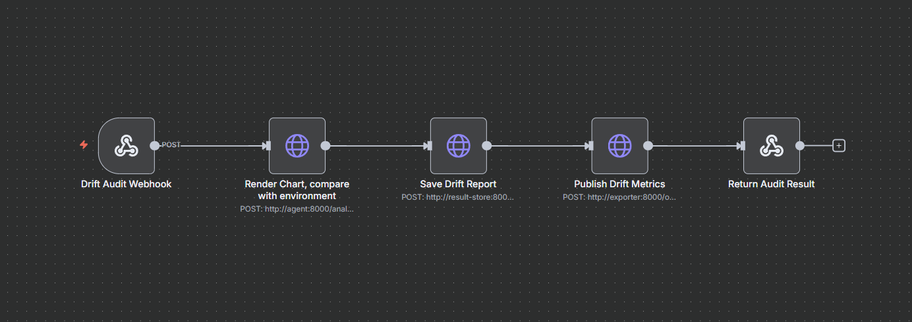
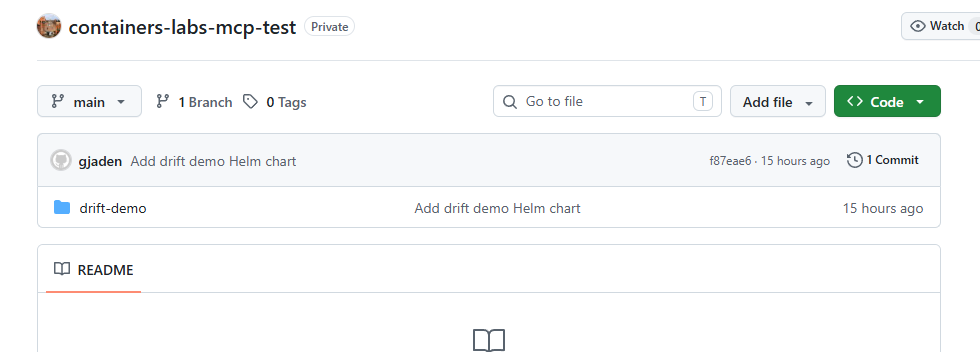
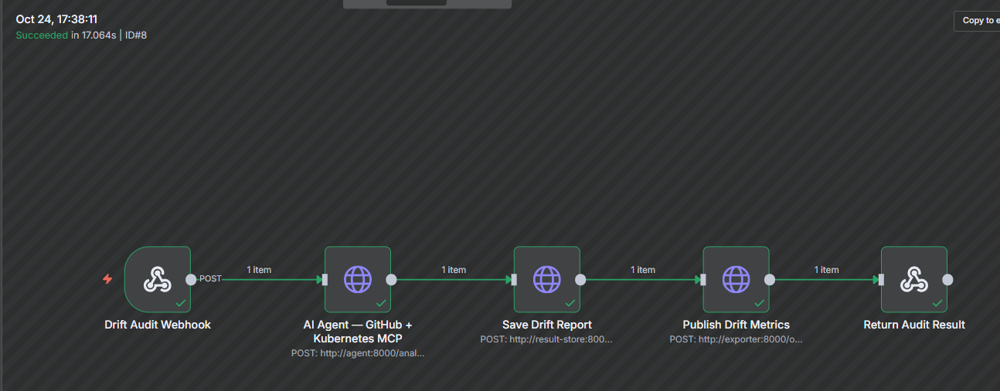
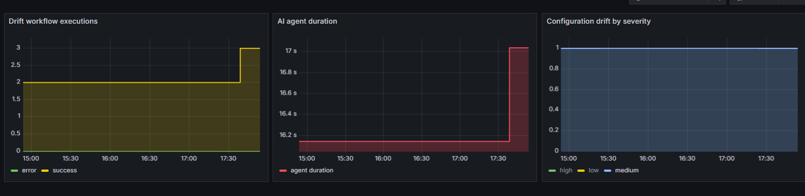

# Kubernetes Configuration Drift Auditor

## Part 1 — Design your use-case

Пусть у нас будет небольшая продуктовая компания, использующая Kubernetes и Helm для доставки приложений. Конфиги чартов лежат в Git и должны проходить обязательный ревью. Но, так как компания еще не доросла до GitOps, а в данной конфигурации нет никакой реконсиляции, изменения на окружении и в гите могут разъехаться: кто-нибудь зайдет в кластер и руками заскейлит поды, изменит образ, добавит env. В целом, как мне кажется, такое приемлемо при аварийной ситуации для наиболее быстрой починки. Однако не всегда ресурсы возвращаются в ожидаемое состояние - люди банально забывают это делать.

Задизайним систему, которая будет помогать инженерам обнаруживать drift в конфигурации между гитом и окружением (k8s), выводит эти значения в качестве метрики через экспортер и алертит на drift, приводя рекомендации по починке, риски.

## Part 2 — Implementation requirements

Получилась такая схема:

Флоу начинается с триггера по вебхуку. Для регулярной проверки можно, например, тригерить его из кронжобы в кубернетесе или scheduled pipeline в Гитлабе.

Далее ИИ-агент подключается к гитхаб репозиторию по указанному в запросе пути и рендерит хельм чарт. Потом он подключается к Кубернетесу и сравнивает манифесты с действительным их состоянием в окружении.

После этого создаётся отчет по расхождению конфигов и рекомендации по исправлению.

### MCP

Для интеграции с системами используются готовые MCP-сервера:

- [`github-mcp-server`](https://github.com/github/github-mcp-server)
- [`kubernetes-mcp-server`](https://github.com/containers/kubernetes-mcp-server)

MCP кубернетеса ограничен конфигом для read-only доступа с безопасными тулами [`mcp/kubernetes-mcp.toml`](mcp/kubernetes-mcp.toml).

### Skills

Первый скилл ограничивает использование агентом инструментов до следующего списка:

- `get_file_contents(owner, repo, path, ref)` для получения чарта из гитхаба;
- `list_commits(owner, repo, path, sha, perPage)` просмотр коммита;
- `resources_get(apiVersion, kind, name, namespace)` получение манифеста из куба;
- `events_list(namespace, limit)` получение событий из куба.

Основной скилл с инструкциями лежит в
[`skills/kubernetes-drift.md`](skills/kubernetes-drift.md).

Агент определяет критичность (severity) расхождения по правилам заданным в скилле:
- high: ресурс отсутствует; расхождение образа, портов, чувствительных env и т.д.
- medium: расхождение реплик, некритичных env
- low: расхождение метаданных

### Workflow в n8n

Всего пять шагов:
- webhook для получения запроса
- Отправляется запрос в агент, который по данным из запроса и используя mcp берет из гитхаба чарт, рендерит его, сравнивает манифесты с кубом
- Сохраняется результат проверки в формате md
- В экспортер отправляется запрос и он экспоузит метрики по работе флоу
- Возвращается ответ на запрос



## Part 3 — Run it locally

Весь стек запускается в docker compose. Модель взял `qwen2.5:1.5b`.

Зальём на гитхаб чарт



И задеплоим в кластер.

После этого руками в кластере сделаем дрифт конфига

```bash
kubectl --namespace drift-demo scale deployment/drift-demo --replicas=3
kubectl --namespace drift-demo set env deployment/drift-demo LOG_LEVEL=debug
kubectl --namespace drift-demo set image deployment/drift-demo nginx=nginx:1.26-alpine
kubectl --namespace drift-demo rollout status deployment/drift-demo --timeout=2m
```

Запускаем флоу:

```bash
curl -sS -X POST http://localhost:5678/webhook/kubernetes-drift \
    -H 'Content-Type: application/json' \
    -d '{
      "repository": "GoldenJaden/containers-labs-mcp-test",
      "ref": "main",
      "chart_path": "drift-demo",
      "namespace": "drift-demo",
      "release": "drift-demo",
      "requested_by": "drift-demo"
    }'
```

В n8n всё прошло успешно



Ответ получился такой:

```json
{
    "repository": "GoldenJaden/containers-labs-mcp-test",
    "ref": "main",
    "chart_path": "drift-demo",
    "namespace": "drift-demo",
    "release": "drift-demo",
    "audited_resources": [
        "Service/drift-demo",
        "Deployment/drift-demo"
    ],
    "verdict": "DRIFT_DETECTED",
    "drift_count": 3,
    "drift_by_severity": {
        "high": 1,
        "medium": 1,
        "low": 1
    },
    "resources_out_of_sync": 1,
    "likely_cause": "The AI classified the evidence as a possible incomplete or inconsistent rollout.",
    "impact": "The deterministic policy priority order is Deployment/drift-demo:spec.template.spec.containers[name=nginx].image → Deployment/drift-demo:spec.replicas → Deployment/drift-demo:spec.template.spec.containers[name=nginx].env[name=LOG_LEVEL].value. These verified configuration differences can affect workload behaviour or availability until Helm reconciliation.",
    "drift": [
        {
            "resource": "Deployment/drift-demo",
            "field": "spec.replicas",
            "desired": 2,
            "live": 3,
            "severity": "medium"
        },
        {
            "resource": "Deployment/drift-demo",
            "field": "spec.template.spec.containers[name=nginx].image",
            "desired": "nginx:1.27-alpine",
            "live": "nginx:1.26-alpine",
            "severity": "high"
        },
        {
            "resource": "Deployment/drift-demo",
            "field": "spec.template.spec.containers[name=nginx].env[name=LOG_LEVEL].value",
            "desired": "info",
            "live": "debug",
            "severity": "low"
        }
    ],
    "actions": [
        "Review whether the live changes were authorized.",
        "Run helm upgrade with the committed chart to restore the declared state.",
        "Run the drift workflow again and verify an IN_SYNC result."
    ],
    "report_path": "reports/drift-demo-drift-demo.md",
    "model": "qwen2.5:1.5b",
    "tool_calls": [
        {
            "step": 1,
            "tool": "get_file_contents",
            "mcp_server": "github-mcp-server",
            "status": "ok",
            "calls": 7,
            "result": "5 chart files"
        },
        {
            "step": 2,
            "tool": "list_commits",
            "mcp_server": "github-mcp-server",
            "status": "ok"
        },
        {
            "step": 3,
            "tool": "resources_get",
            "mcp_server": "kubernetes-mcp-server",
            "status": "ok",
            "calls": 2,
            "resources": [
                "Service/drift-demo",
                "Deployment/drift-demo"
            ]
        },
        {
            "step": 4,
            "tool": "events_list",
            "mcp_server": "kubernetes-mcp-server",
            "status": "ok"
        }
    ]
}
```

Агент проверил оба манифеста чарта. `Service` совпал целиком, а в `Deployment`
нашлись все три отличия и были классифицированы по степени риска: Image получил high severity, replicas - medium, а env `LOG_LEVEL` - low.

В ответе пришёл сам drift, рекомендации по устранению, риск, произведенные шаги, какая использовалась модель и другие метаданные.

## Part 4 — Monitoring

В компоузе поднимается пром и графана. Наш флоу передает экспортеру данные о выполнении. Пром скрейпит экспортер и потом мы всё визуализируем в графане. Сделал 3 графика:

Первый график показывает успешные и ошибочные выполнения.

Второй показывает длительность работы шага с ИИ-агентом (в т.ч. использование MCP для доступа к системам)

Третий шаг показывает количество расхождений в конфигурации по severity.



Можно было бы настроить такие алерты:

- `drift_items{severity="high"} > 0` - Есть серьезные расхождения в конфигурации
- `drift_items{severity="medium"} > 1` - Есть средние расхождения в конфигурации
- `drift_last_success_timestamp_seconds > 0
and (time() - drift_last_success_timestamp_seconds > 1800)` - Метрик по флоу не было последние 60 минут - полезно, если мы гоняем например по кронжобе раз в полчаса. Этот алерт поможет понять, что прогон по расписанию не прошел.
